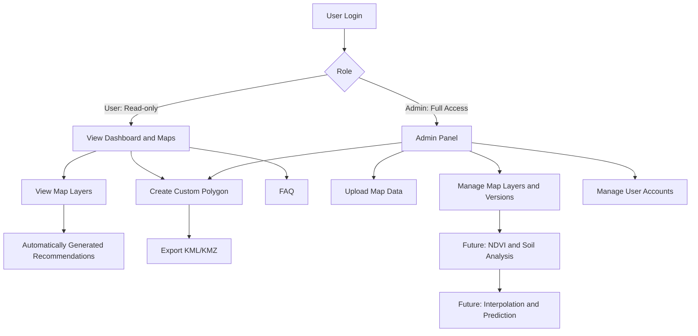

# SIMPONI TP

SIMPONI TP is a web-based precision agriculture platform for managing agricultural areas, UAV-derived geospatial data, drone operation planning, and decision support.

The project combines UAV imagery, GIS layers, soil measurements, and operational recommendations to support agricultural monitoring and spraying missions.

## Project Goals

- Display agricultural areas and geospatial layers on a web dashboard.
- Upload and manage map datasets such as NDVI and GeoTIFF files.
- Divide operational areas into 100 x 100 meter blocks.
- Define custom spraying polygons.
- Provide basic intensity-based recommendations.
- Export grids and custom polygons as KML/KMZ files for drone mission planning.
- Prepare the platform for future soil analysis and agricultural intelligence.

## System Flowchart



## Recommended Architecture

SIMPONI TP uses a modular monolith to keep the first release simple while leaving room for future geospatial processing.

```text
Next.js dashboard
        |
        v
FastAPI REST API
        |
        +--> PostgreSQL + PostGIS
        |
        +--> Uploaded GeoTIFF and generated KML/KMZ files
```

### Technology Stack

- **Frontend:** Next.js, TypeScript, and Tailwind CSS.
- **Map interface:** MapLibre GL JS.
- **Backend:** FastAPI and Python.
- **Database:** PostgreSQL with PostGIS.
- **File storage:** Local storage for development; S3-compatible storage can be added later.
- **Authentication:** HTTP-only cookie-based sessions with `user` and `admin` roles.
- **Deployment:** Docker Compose.

The `user` role has limited access: it can view dashboards, map layers, and automatically generated recommendations, create a custom polygon, and export that polygon as KML/KMZ. The `admin` role has full access to uploads, map and layer management, exports, and user accounts.

## Repository Structure

```text
simponitp/
├─ apps/
│  ├─ web/          # Next.js dashboard and map interface
│  └─ api/          # FastAPI API and business logic
├─ packages/        # Shared contracts or utilities, only when needed
├─ database/        # PostgreSQL/PostGIS migrations
├─ storage/         # Uploaded and generated geospatial files
├─ docs/            # Technical and project documentation
├─ docker-compose.yml
└─ README.md
```

## Planned Backend Modules

- `auth` - authentication, sessions, and role checks.
- `users` - user and administrator management.
- `maps` - map uploads, layers, and map versions.
- `grids` - operational block generation.
- `recommendations` - configurable intensity and action recommendations.
- `exports` - KML/KMZ generation.
- `processing` - future NDVI, interpolation, and prediction workflows.

## Current Status

The repository is at the planning and initial setup stage. Phase 1 scope, architecture, and technology choices have been defined. Implementation details, recommendation rules, GeoTIFF specifications, drone compatibility requirements, and final demonstration dates still require confirmation.

## Important Data Notes

The Kayangan area dataset is a proposed initial dataset and must be verified before use. Required data may include UAV imagery, NDVI/GeoTIFF files, agricultural boundaries, soil sample coordinates, and soil parameter values.

Do not commit private datasets, credentials, or sensitive operational information to this repository.

## Future Integrations

- ArcGIS Cloud or another geospatial data provider.
- Middleware for dataset transfer.
- Drone mission planning software such as TrueSprayer.
- Soil sensor and agricultural intelligence workflows.

## License

License information will be added when the project licensing decision is finalized.
